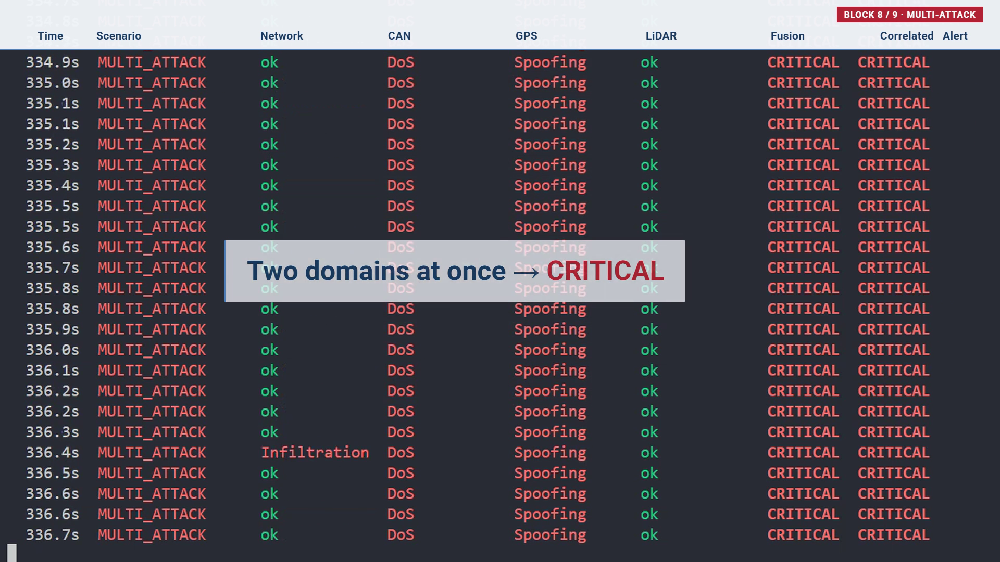
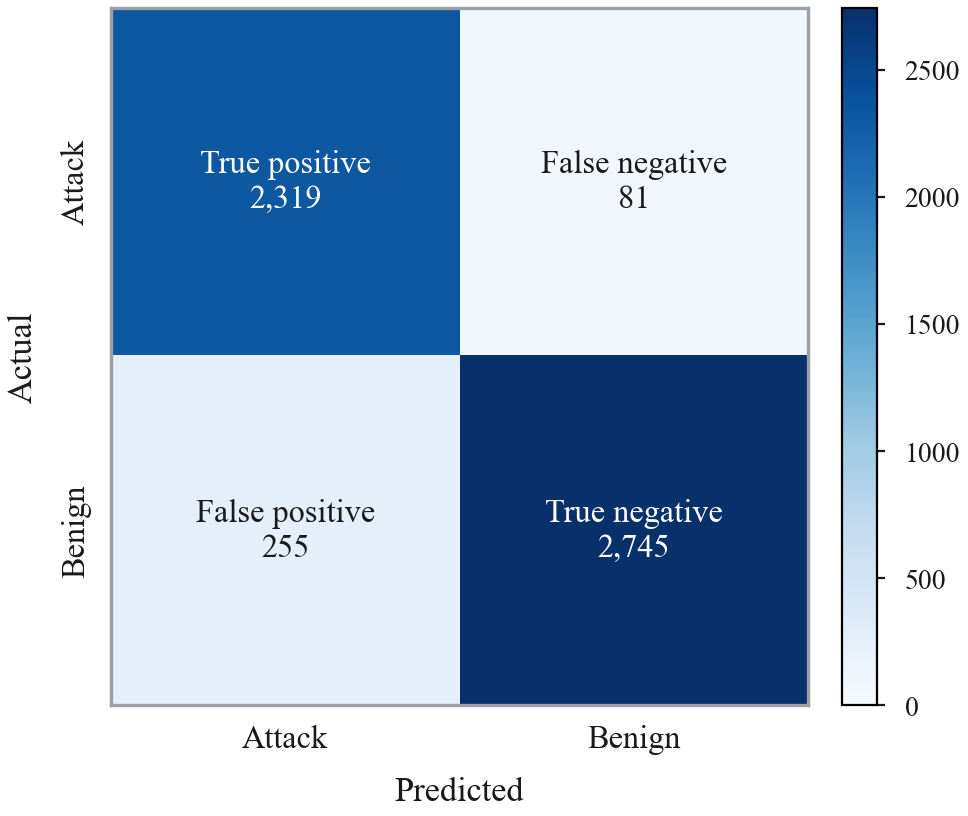
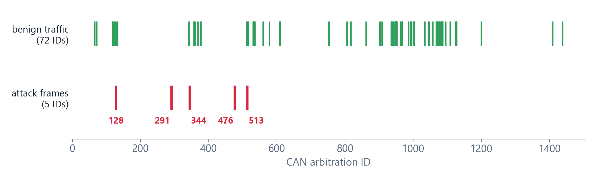

# Multi-Domain Intrusion Detection for Autonomous Vehicles

Master's thesis project, Tunisia Polytechnic School (EPT), University of Carthage, 2026.

An autonomous vehicle trusts data coming from several channels: its internal CAN bus, GPS, LiDAR and its network links. Most intrusion detection systems watch only one of them. This project watches four at the same time, combines their outputs into one graded alert, explains each alert, and runs the whole chain in a real-time simulation.



## How it works

```
 network flows   CAN frames   GPS fixes   LiDAR scans
       |             |            |            |
       +------ windowing engine (groups data per sensor) ------+
       |             |            |            |
   network IDS    CAN IDS      GPS IDS     LiDAR IDS        (XGBoost, class probabilities)
       |             |            |            |
       +-------------+------------+------------+
                     |
               fusion engine  (rule-based / weighted / meta-classifier)
                     |
             temporal correlator  (last 10 alerts, escalates persistent attacks)
                     |
        response module  +  SHAP explanation
```

- **Four detectors**, one per domain, all XGBoost. Each one returns class probabilities, 19 values in total, so the fusion receives the same kind of input from every domain.
- **Fusion engine** with three strategies. The live system uses the rule-based one: one confident domain gives MEDIUM, two or more give CRITICAL.
- **Temporal correlator**: if at least 60% of the last 10 alerts are attacks (MEDIUM or above), the current level is raised by one.
- **Response module**: from a log entry up to an ISOLATE flag file at CRITICAL. The IDS never acts on the vehicle itself.
- **Zero-day layer**: a One-Class SVM on the 19 probabilities, trained on normal data only. It works offline but was not stable in live use, so it only adds an informational `[ZD]` tag.
- **Explainability**: exact SHAP values (TreeExplainer) on the fusion meta-classifier.

## Results

| Domain | Dataset | Accuracy | Note |
|---|---|---|---|
| Network | CICIDS2017 | 91.04% | 90.58% on rows never used in training |
| CAN bus | CICIoV2024 | ~100% | 0 errors on 281,644 held-out frames |
| GPS | AV-GPS-Dataset | 99.98% | 97.48% on a recording never used in training |
| LiDAR | KITTI + simulated attacks | 99.63% | 99.38% on unseen samples |

**Live simulation**, 5,400 cycles (3,000 normal, 2,400 attack), normal traffic not filtered:

| Accuracy | Precision | Recall | F1 | False-alarm rate |
|---|---|---|---|---|
| 93.78% | 90.09% | 96.62% | 93.24% | 8.5% |



## Limitations

These are stated in the thesis and worth knowing before reusing the results:

- The network detector is trained on general IT traffic (CICIDS2017), not vehicle traffic. It is the weakest part and causes most of the false alarms.
- In CICIoV2024 the attack frames use CAN IDs that never appear in normal traffic, which makes CAN detection easy on this dataset. An attacker reusing legitimate IDs would be much harder to catch.

  

- There is no public LiDAR dataset with labelled attacks, so the three LiDAR attacks (PointDrop, IntensitySpoof, GhostCluster) are simulated on real KITTI scans.
- The four datasets were recorded separately, so every multi-domain sample is assembled. The project does not claim to detect real coordinated attacks.
- All timings were measured on a desktop computer, not on vehicle hardware.

## Running it

Python 3.9+.

```
pip install -r requirements.txt
```

The datasets are not included (they belong to their authors). See [data/README.md](data/README.md) for where to download them and where to put them. The trained models are included, so the tests and demos run without retraining.

```
python network/network_test.py        # each detector has a *_test.py
python fusion/fusion_test.py          # compares the three fusion strategies
python integration_test.py            # end-to-end test on all four domains
python simulation/build_simulation_dataset.py
python simulation/live_simulator.py   # real-time run, prints a live feed
python temporal/temporal_demo.py      # small demos of single modules
python response/response_demo.py
python windowing/window_demo.py
```

To retrain a detector: `python <domain>/<domain>_train.py`.

## Repository layout

| Folder | Content |
|---|---|
| `network/`, `can/`, `gps/`, `lidar/` | training, inference (`*_runner.py`), tests and trained models |
| `unsupervised/` | One-Class SVM zero-day layer |
| `fusion/` | fusion engine and meta-classifier |
| `temporal/`, `response/`, `windowing/` | correlator, response module, windowing engine |
| `explainability/` | SHAP analysis |
| `simulation/` | live simulator and its scenario builder |
| `docs/` | figures used in this README |

## Author

**Mhamed Nouira**, Research Master's in IoT and Data Processing, Tunisia Polytechnic School (EPT), University of Carthage.
Supervised by Dr. Hichem Mrabet. Thesis defended on 17 October 2026.

If you use this work, please cite:

```
M. Nouira, "Design and Implementation of a Multi-Domain Intrusion Detection System
for Autonomous Vehicles using Machine Learning", Master's thesis,
Tunisia Polytechnic School, University of Carthage, 2026.
```

## Credits

- The network detector's preprocessing (k-means sampling, information-gain feature selection) and its tuned hyperparameters are adapted from **MTH-IDS** by Li Yang, Abdallah Moubayed and Abdallah Shami, Western University ([repository](https://github.com/Western-OC2-Lab/Intrusion-Detection-System-Using-Machine-Learning), MIT licence). See [THIRD_PARTY_NOTICES.md](THIRD_PARTY_NOTICES.md).
- Datasets: CICIDS2017 and CICIoV2024 (Canadian Institute for Cybersecurity, UNB), AV-GPS-Dataset (Abrar et al.), KITTI (Geiger et al.).

## Licence

Code under the MIT licence, see [LICENSE](LICENSE). The datasets keep their own licences.
